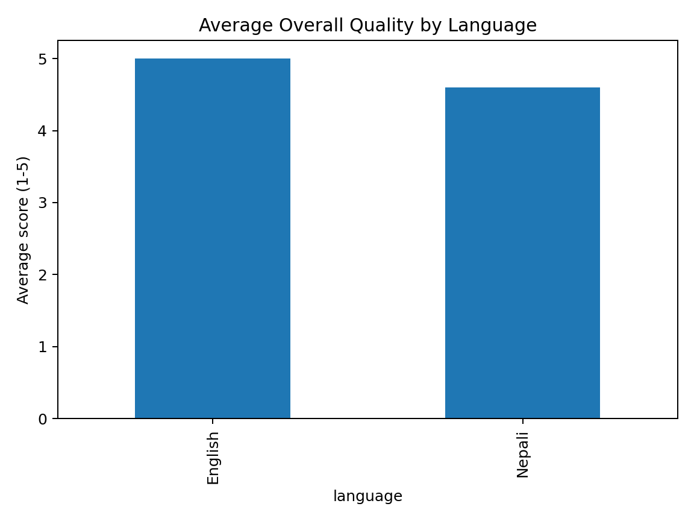

## Results

The initial evaluation included 10 English and Nepali AI responses across summarization, instruction following, translation, factual consistency, and contextual reasoning tasks.

### Key Findings

- English responses achieved an average overall quality score of 5.0/5.
- Nepali responses achieved an average overall quality score of 4.6/5.
- 8 of 10 responses had no identified evaluation error.
- 1 response failed an explicit instruction constraint.
- 1 response was incomplete relative to the prompt requirements.
- No hallucinations were identified in the evaluated sample.

The evaluation highlighted how structured rubrics can surface quality issues that may not be obvious from general response fluency alone. In particular, responses can remain factually accurate and linguistically strong while still failing explicit task constraints.

## Limitations

This is a small portfolio-scale evaluation rather than a comprehensive model benchmark. The dataset contains only 10 evaluated responses, so the results should not be generalized to overall model performance. Future work could expand the dataset, include multiple models, use multiple human evaluators, and measure inter-rater agreement.

## Evaluation Visualization

